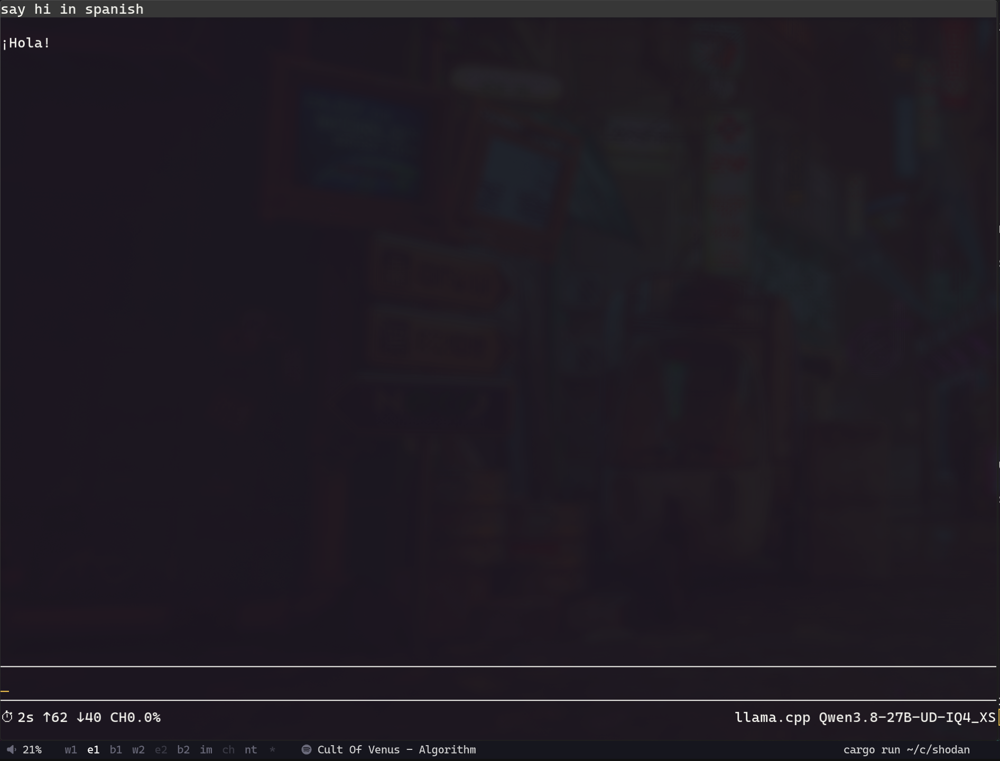

# Shodan 

Shodan is a console agent inspired by pi.

It uses switchable system prompts instead of skills. Users can choose the instructions needed for a task and conserve tokens, allowing [local inference](https://github.com/ksevelyar/playground-inference) models to perform better.

## Documentation
* [Architecture](doc/architecture.md)
* [Boundaries](doc/boundaries.md)

### Features
* [Chat](doc/features/chat.md)
* [Run bash commands](doc/features/tools/bash.md)
* [List directory](doc/features/tools/ls.md)
* [Read file](doc/features/tools/read.md)
* [Plan mode](doc/features/modes/plan.md)
* [llama provider](doc/features/providers/llama.md)
* [OpenAI provider](doc/features/providers/openai.md)
* [Models](doc/features/models.md)
* [Response recording](doc/features/responses-recording.md)
* [Status panel](doc/features/status-panel.md)
* [TUI](doc/tui.md)
